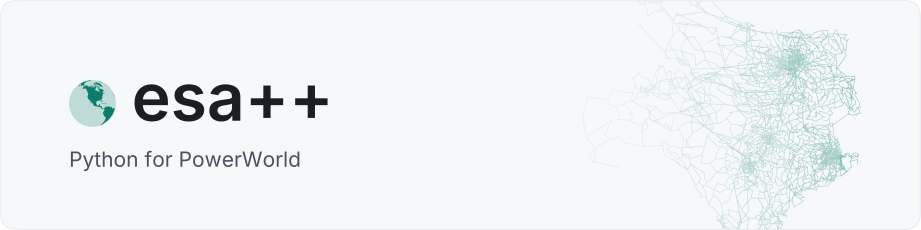

<h1>
  <picture>
    <source media="(prefers-color-scheme: dark)" srcset="https://raw.githubusercontent.com/BirchfieldResearchGroup/esapp/main/docs/_static/banner-dark.svg">
    
  </picture>
</h1>

[](https://github.com/BirchfieldResearchGroup/esapp/actions/workflows/ci.yml)
[](https://pypi.org/project/esapp/)
[](https://pypi.org/project/esapp/)
[](https://esapp.readthedocs.io)
[](https://github.com/BirchfieldResearchGroup/esapp/blob/main/LICENSE)

esa++ is Python for PowerWorld. Read and write Simulator data as pandas DataFrames, run any script
command, and get transient stability results as NumPy arrays. Every object type and field is typed.

[Documentation](https://esapp.readthedocs.io): guide, examples, catalog and API.

```bash
pip install esapp
```

Needs Windows and PowerWorld Simulator with SimAuto.

```python
from esapp import PowerWorld
from esapp.grid import Bus, Gen

with PowerWorld("Hawaii40.pwb") as pw:
    pw.pf.solve()
    low = pw[Bus, Bus.BusName, Bus.BusPUVolt < 0.97]  # filtered inside Simulator
    pw[Gen, Gen.GenMW, Gen.AreaNum.eq(1)] = 50.0  # sets only the matching generators
```

| Module | Contents |
| --- | --- |
| `esapp` | `PowerWorld`, the session: reading, writing, selecting, commands and analyses |
| `esapp.grid` | Simulator's object types and their fields |
| `esapp.commands` | every script command, as a typed class |
| `esapp.ctg` | contingencies |
| `esapp.matrix` | the Ybus, Jacobian and G-matrix as labelled sparse arrays (`esapp[sparse]`) |
| `esapp.ts` | transient stability: contingencies, play-ins and results |
| `esapp.testing` | pytest fixtures and a fake SimAuto, to test without PowerWorld (`esapp[testing]`) |

## Author

[Luke Lowery](https://lukelowry.github.io/), PhD student in the
[Birchfield Research Group](https://birchfield.engr.tamu.edu/) at Texas A&M University ·
[Google Scholar](https://scholar.google.com/citations?user=CTynuRMAAAAJ&hl=en) ·
[ORCID](https://orcid.org/0009-0000-0029-3403)

Also by the author: [pyvectorfit](https://pyvectorfit.readthedocs.io), vector fitting for EMT line
models · [OpenLine](https://openline.readthedocs.io), overhead transmission lines ·
[latkit](https://latkit.readthedocs.io), GPU visualization of large networks.
